<div align="center">

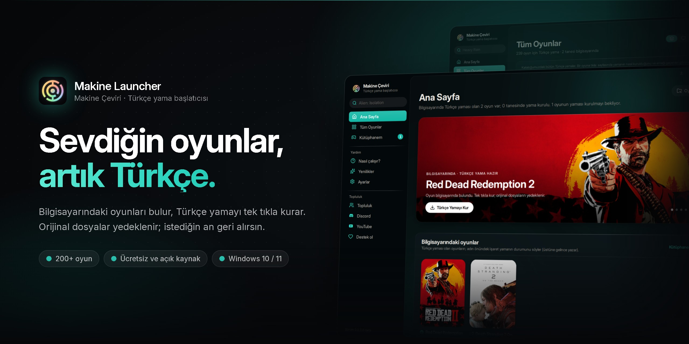

<br>
<br>

<a href="https://apps.microsoft.com/detail/9NQMT44PRWHG?mode=direct"></a>

<br>

[](https://github.com/MakineCeviri/Makine-Launcher/releases/latest)
[](https://makineceviri.org/oyunlar)
[](https://github.com/MakineCeviri/Makine-Launcher/actions/workflows/ci.yml)
[](LICENSE)
[](https://discord.com/invite/makine-ceviri-885595211806441482)
<br>


**[makineceviri.org](https://makineceviri.org)** &nbsp;·&nbsp; **[İndir](#indir)** &nbsp;·&nbsp; **[Nasıl çalışır](#nasil-calisir)** &nbsp;·&nbsp; **[Geliştir](#gelistirme)** &nbsp;·&nbsp; **[Yol haritası](#yol-haritasi)** &nbsp;·&nbsp; **[Kurulum videoları](https://www.youtube.com/@Makine-Ceviri)**

</div>

<br>

**Makine Launcher**, bilgisayarındaki oyunları bulan ve Türkçe yamalarını tek tıkla kuran, ücretsiz ve açık kaynak bir Windows uygulamasıdır. [Makine Çeviri](https://makineceviri.org) topluluğunun 200'ü aşkın oyunluk Türkçe yama kataloğunu tek bir yerde toplar. Hangi oyununun yaması olduğunu söyler, yamayı indirip doğrular, kurmadan önce oyunun orijinal dosyalarını yedekler ve istediğin an her şeyi geri alır.

Makine Çeviri kâr amacı gütmeyen bir topluluktur. Yamalar gönüllü çevirmenlerin emeğidir; launcher'da reklam yoktur, kullanmak için hesap açman gerekmez.

<div align="center">
<br>

<sub>Tüm Oyunlar → Kütüphanem → oyunun sayfası → Ayarlar'da vurgu rengi. Görüntüler uygulamanın kendisinden.</sub>
</div>

<br>

## Neler yapar

<table>
<tr>
<td width="50%" valign="top">

**Oyunlarını kendisi bulur**<br>
Steam, Epic Games, GOG, Ubisoft Connect ve Xbox kütüphanelerini, yaygın oyun klasörlerini tarar. Steam dışındaki oyunları dosyalarının parmak iziyle tanır. Bulamadığı bir oyunun klasörünü pencereye sürükleyip bırakman yeter.

</td>
<td width="50%" valign="top">

**Tek tıkla Türkçe**<br>
Doğru yamayı indirir, bütünlüğünü doğrular ve oyunun klasörüne kurar. Birden çok seçeneği olan yamalarda seçimi sana bırakır.

</td>
</tr>
<tr>
<td valign="top">

**Orijinal dosyaların güvende**<br>
Yamanın değiştireceği dosyalar kurulumdan önce yedeklenir. "Kaldır" dediğinde oyun eski hâline döner. Yedek yarıda kalırsa kurulum hiç başlamaz.

</td>
<td valign="top">

**Kendi programı olan yamalar**<br>
Bazı yamalar kendi kurulum aracıyla gelir. Launcher aracı geçici bir kopyadan, oyunun klasörünü vererek çalıştırır; ne yazdığını konsolda gösterir, "devam etmek için bir tuşa basın" gibi duraklamaları kendisi geçer.

</td>
</tr>
<tr>
<td valign="top">

**Güncel kalır**<br>
Katalog arka planda yenilenir. Kurduğun bir yama güncellenince oyunun üstünde "Güncelleme var" belirir. Launcher'ın yeni sürümünü de kendisi haber verir.

</td>
<td valign="top">

**Riskleri önceden söyler**<br>
Oyun açıkken kurulum yapılmaz. Hile koruması olan oyunlarda online oynamanın riskini kurmadan önce anlatır. Yöneticilik izni yalnızca korumalı bir klasöre yazarken, yalnızca o iş için istenir.

</td>
</tr>
<tr>
<td valign="top">

**Emeği görünür**<br>
Her oyunun sayfasında yamayı kimin hazırladığı, yama notları ve kurulumdan sonra bilmen gerekenler durur.

</td>
<td valign="top">

**Sana göre görünür**<br>
Açık ve koyu görünüm, on vurgu rengi, akıcı animasyonlar. Yavaş bilgisayarlarda animasyonları kapatabilir, grafik arabirimini değiştirebilirsin.

</td>
</tr>
</table>

## Ekranlar

<table>
<tr>
<td width="50%">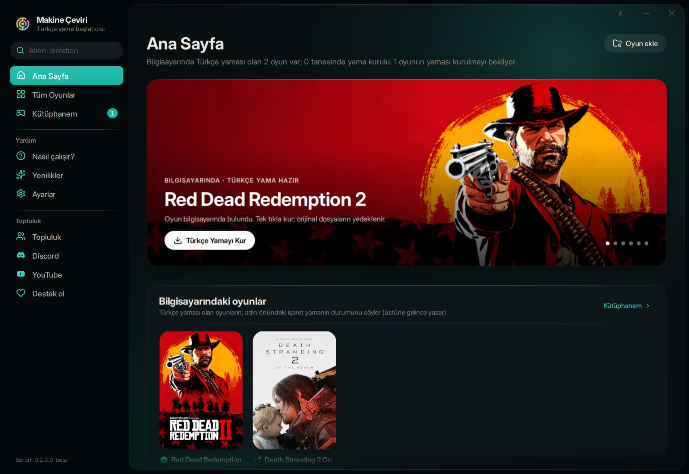<br><sub><b>Ana Sayfa</b>: bilgisayarındaki oyunlar, yaması hazır olanlar ve öne çıkanlar</sub></td>
<td width="50%">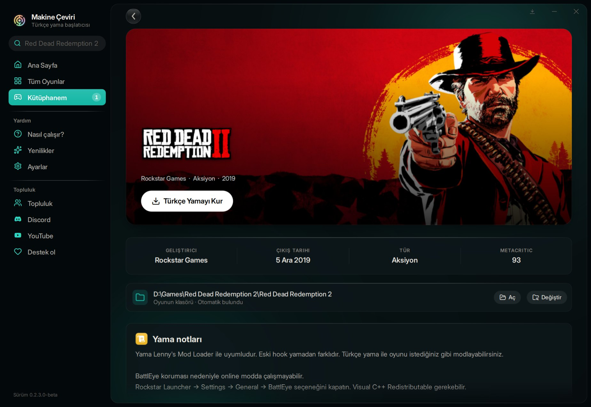<br><sub><b>Oyun sayfası</b>: tek tıkla kurulum, oyunun klasörü, yama notları ve emeği geçenler</sub></td>
</tr>
<tr>
<td>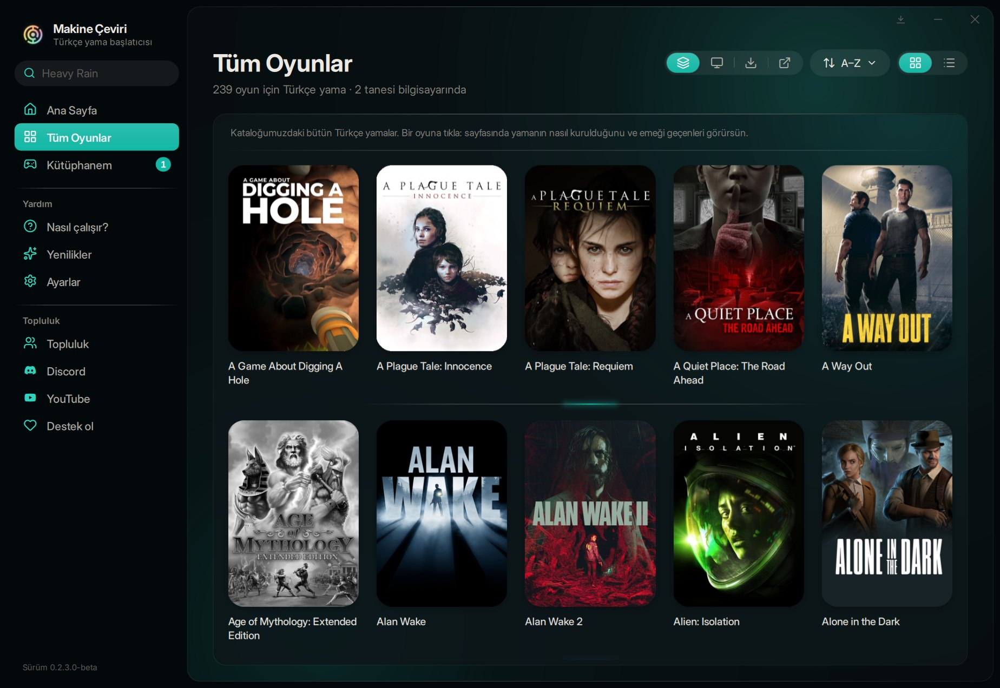<br><sub><b>Tüm Oyunlar</b>: kataloğun tamamı; süzgeç, sıralama, ızgara ve liste görünümü</sub></td>
<td>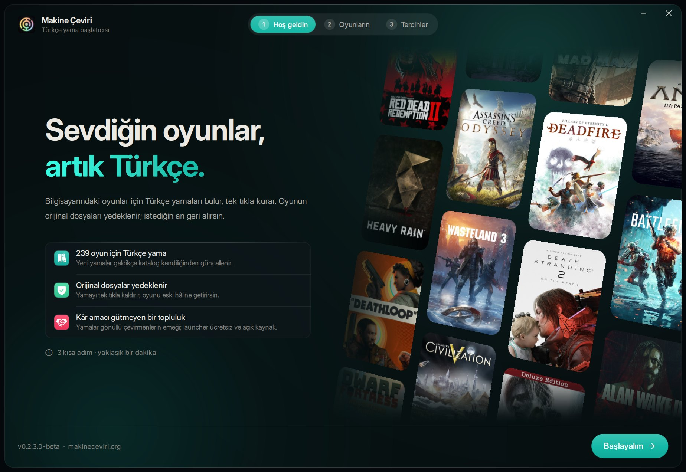<br><sub><b>Hoş geldin</b>: üç kısa adımda ilk kurulum</sub></td>
</tr>
<tr>
<td>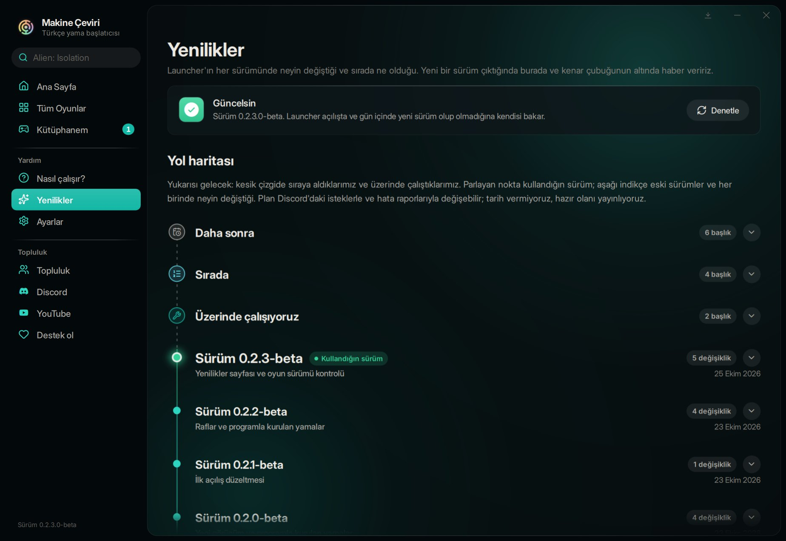<br><sub><b>Yenilikler</b>: her sürümde ne değişti, sırada ne var</sub></td>
<td>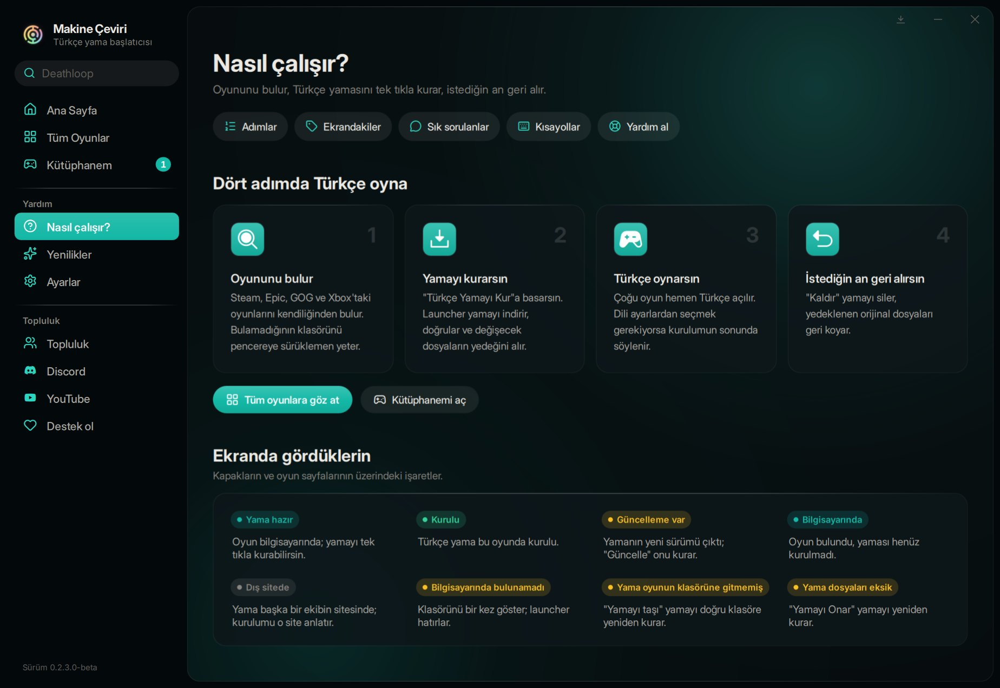<br><sub><b>Nasıl çalışır</b>: adımlar, ekrandaki işaretler, sık sorulanlar</sub></td>
</tr>
<tr>
<td>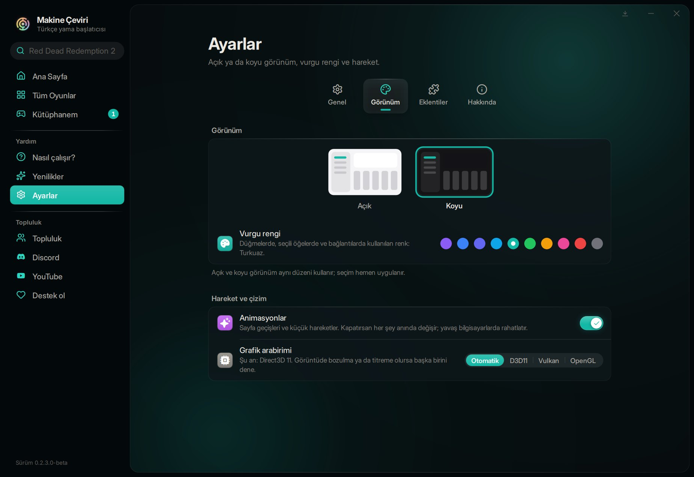<br><sub><b>Görünüm</b>: açık ve koyu, vurgu rengi, animasyonlar</sub></td>
<td>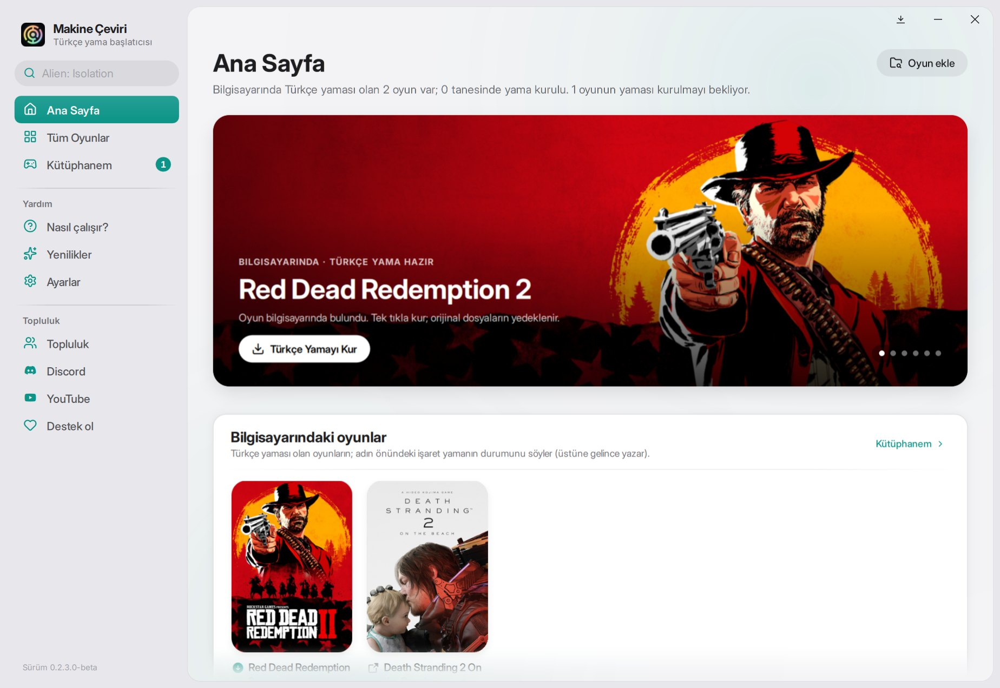<br><sub><b>Açık görünüm</b>: aynı düzen, aydınlık tonlarda</sub></td>
</tr>
</table>

<a id="indir"></a>

## İndir

| | Nasıl | Güncelleme |
|---|---|---|
| **[Microsoft Store](https://apps.microsoft.com/detail/9NQMT44PRWHG)** (önerilen) | Store'dan kur, Başlat menüsünden aç. | Store kendiliğinden günceller. |
| **[GitHub Releases](https://github.com/MakineCeviri/Makine-Launcher/releases/latest)** | ZIP'i bir klasöre aç, `Makine-Launcher.exe`'yi çalıştır. Kurulum gerekmez. | Yeni sürüm çıkınca launcher haber verir, sayfasını açar. |

**Gereksinimler:** Windows 10 veya 11, 64 bit. Yamaları indirmek için internet bağlantısı.

Kurulumu adım adım görmek istersen: [YouTube'daki kurulum videoları](https://www.youtube.com/@Makine-Ceviri) ve [makineceviri.org/indir](https://makineceviri.org/indir).

<a id="nasil-calisir"></a>

## Nasıl çalışır

Bir yamanın çevirmenden oyuncuya yolculuğu:

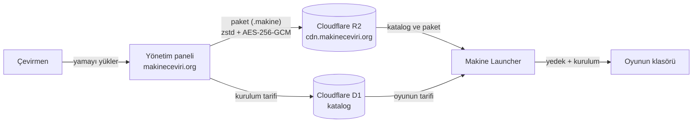

1. **Tanır.** Launcher kütüphaneleri tarar; her oyunu Steam kimliğiyle ya da dosyalarının parmak iziyle kataloğa eşler. Bazı yamalarda oyununun, yamanın hazırlandığı sürüm olup olmadığına da bakar.
2. **İndirir ve doğrular.** Paket Cloudflare R2'den iner; katalog paketin SHA-256 özetini yayımlıyorsa önce o karşılaştırılır. Paket AES-256-GCM ile şifreli ve kimlik doğrulamalı olduğu için bozuk ya da eksik inen bir paket açılmaz, kurulmaz.
3. **Yedekler.** Değişecek her dosyanın orijinali saklanır. Yedek tamamlanmadan oyuna dokunulmaz.
4. **Kurar.** Dosyalar oyunun klasörüne kopyalanır ya da yamanın kendi programı çalıştırılır. Program bitince klasörde gerçekten ne değiştiği ölçülür; hiçbir şey değişmediyse kurulum olmamış sayılır.
5. **Geri alır.** "Kaldır" yedeği geri koyar. Bir işlem yarıda kesilirse (elektrik gitti, bilgisayar kapandı) kurtarma günlüğü sayesinde launcher bir sonraki açılışta yarım kalan işi toparlar.

Ayrıntılar: [kurulum akışı](https://github.com/MakineCeviri/Makine-Launcher/blob/dev/docs/install-flow.md) · [oyun tanıma](https://github.com/MakineCeviri/Makine-Launcher/blob/dev/docs/game-detection.md) · [yamanın kendi programı](https://github.com/MakineCeviri/Makine-Launcher/blob/dev/docs/patch-programs.md)

## Güvenlik ve gizlilik

- **Paketler doğrulanır.** Her paket şifreli ve kimlik doğrulamalıdır (AES-256-GCM); yolda değişen ya da yarım inen bir paket kurulmaz.
- **Oyunun bozulmaz.** Orijinal dosyalar yedeklenir, kurulum ve kaldırma kesintiye karşı günlükle korunur.
- **İzin yalnızca gerektiğinde.** Launcher normal kullanıcı olarak çalışır. Korumalı bir klasöre yazmak gerekirse yalnızca o dosya işlemleri için yönetici izni ister.
- **Kişisel veri toplanmaz.** Launcher her işlemin yalnızca sonucunu (kurulum başarılı mı, başarısızsa hangi hata kodu) anonim bir kurulum kimliği ve sürümle sayar; klasör yolları, kullanıcı adı ya da dosya içeriği gönderilmez. Çökme ve hata raporları (Sentry) aynı kurala uyar ve **Ayarlar → Genel**'den kapatılabilir.
- **Açık kaynak.** Launcher'ın yaptığı her şey bu depoda; derleyip kendin çalıştırabilirsin.

Bir güvenlik açığı bulduysan lütfen herkese açık bir issue yerine [SECURITY.md](SECURITY.md)'deki yoldan bildir.

## Sık sorulanlar

<details>
<summary><b>Ücretli mi?</b></summary>
<br>
Hayır. Launcher da yamalar da ücretsiz. Makine Çeviri kâr amacı gütmez; projeyi desteklemek istersen <a href="https://makineceviri.org/destekci-ol">destekçi olabilirsin</a>.
</details>

<details>
<summary><b>Oyunum bozulur mu?</b></summary>
<br>
Yamanın değiştirdiği her dosyanın orijinali kurulumdan önce yedeklenir. Yamayı kaldırdığında oyun ilk hâline döner. Oyun bir güncelleme aldıktan sonra yama düzgün çalışmazsa oyunun sayfasından yeniden kurabilirsin.
</details>

<details>
<summary><b>Online oyunlarda sorun olur mu?</b></summary>
<br>
Hile koruması (anti-cheat) olan oyunlarda dosya değiştirmek online modda risk taşıyabilir. Launcher bu oyunlarda kurmadan önce seni uyarır; karar senindir.
</details>

<details>
<summary><b>Oyunumu bulamadı, ne yapmalıyım?</b></summary>
<br>
Kütüphanem'deki "Oyun ekle"ye tıkla ya da oyunun klasörünü pencereye sürükleyip bırak. Oyun katalogdaysa launcher onu tanır.
</details>

<details>
<summary><b>İstediğim oyunun yaması yok.</b></summary>
<br>
Katalog, Makine Çeviri ekibinin ve topluluğun hazırladığı yamalarla büyüyor. İsteğini <a href="https://discord.com/invite/makine-ceviri-885595211806441482">Discord</a>'da paylaşabilir, çevirmen olarak <a href="https://makineceviri.org/basvuru">ekibe katılabilirsin</a>.
</details>

<a id="yol-haritasi"></a>

## Yol haritası

Launcher'daki **Yenilikler** sayfası her sürümde neyin değiştiğini ve sırada ne olduğunu gösterir; kaynağı [`qml/resources/whatsnew.json`](https://github.com/MakineCeviri/Makine-Launcher/blob/dev/qml/resources/whatsnew.json).

- **Üzerinde çalışıyoruz:** her yamada oyun sürümü kontrolü · oyun güncellenince yamayı tek tıkla onarmak
- **Sırada:** bulunamayan oyunu bütün disklerde aramak · Xbox (Game Pass) ve EA app kütüphaneleri · kurmadan önce boş alan denetimi · mod yükleyiciyle açılan oyunları sayfasından başlatmak
- **Daha sonra:** eklentiler · ana sayfada yama haberleri · oyun sürümüne uygun yamayı kendiliğinden seçmek · yama istekleri · yalnızca değişen dosyaları indiren yama güncellemeleri

<a id="gelistirme"></a>

## Geliştirme

Geliştirme **`dev`** dalında yürür; sürümler bu dalda etiketlenir.

| Araç | Sürüm |
|---|---|
| Windows | 10 veya 11, 64 bit |
| Qt | 6.11 (MinGW 13.1 kiti) |
| CMake · Ninja | 3.28+ · Qt ile gelen |
| vcpkg | OpenSSL, zstd, nlohmann/json, spdlog, GoogleTest (`just setup-tests`) |
| [just](https://github.com/casey/just) | komut çalıştırıcı (isteğe bağlı) |
| Python | 3 (yardımcı betikler) |

```bash
git clone -b dev https://github.com/MakineCeviri/Makine-Launcher.git
cd Makine-Launcher
just setup-tests    # vcpkg bağımlılıkları, bir kez

# Paket anahtarı yalnızca ekipte; kendine bir deneme anahtarı üret (CI de böyle derler)
python -c "import pathlib, secrets; pathlib.Path('scripts/.encryption_key').write_text(secrets.token_hex(32))"
python scripts/generate_key_header.py

just dev            # çekirdek + arayüz + testler
just run            # derle ve çalıştır
just test           # bütün test takımları (GoogleTest + CTest)
```

Deneme anahtarıyla derlenen launcher her yönüyle çalışır; yalnızca katalogdaki resmi paketleri açamaz. İki dosya da (`scripts/.encryption_key`, `encryption_key.h`) `.gitignore`'dadır. PATH ayarları ve kod kuralları: [CONTRIBUTING.md](CONTRIBUTING.md).

**Okunacaklar:** [tasarım rehberi](https://github.com/MakineCeviri/Makine-Launcher/blob/dev/docs/design.md) (yeni arayüz bundan kurulur) · [mimari kararlar (ADR)](https://github.com/MakineCeviri/Makine-Launcher/tree/dev/docs/adr) · [sürüm yayınlama](https://github.com/MakineCeviri/Makine-Launcher/blob/dev/docs/RELEASING.md) · [telemetri](https://github.com/MakineCeviri/Makine-Launcher/blob/dev/docs/telemetry.md)

### Mimari

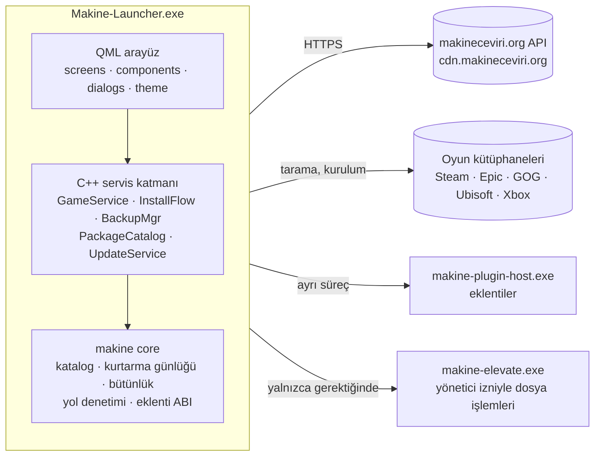

| Katman | Teknoloji |
|---|---|
| Arayüz | Qt 6.11 Quick / QML; Inter yazı tipi; Lucide, Phosphor ve Simple Icons'tan üretilen simge fontları |
| Servis ve çekirdek | C++23 · MinGW 13.1 (MSVC 2022 de derlenir) · OpenSSL · zstd · nlohmann/json · spdlog |
| Paketler | `.makine`: tar + zstd + AES-256-GCM; delta yamalar için xdelta3 |
| Sunucu tarafı | Cloudflare Workers + D1 (katalog, tarifler) ve R2 (paketler, görseller) |
| Test ve CI | GoogleTest + CTest; her `dev` push'unda GitHub Actions'ta Windows derlemesi ve testler |
| Dağıtım | MSIX (Microsoft Store) ve taşınabilir ZIP (GitHub Releases) |

```
core/                 C++ çekirdek kitaplık: katalog, kurtarma günlüğü, bütünlük, eklenti ABI
qml/
  qml/                arayüz: screens · components · dialogs · controllers · theme
  src/                servis katmanı ve uygulamanın girişi (main.cpp)
  resources/          yazı tipleri, simgeler, görseller, whatsnew.json
tests/                ui · integration · plugins test takımları
tools/
  plugin-host/        eklentileri ayrı süreçte çalıştıran, Qt'siz host
  elevate/            yönetici izni gereken dosya işlemlerini yapan küçük yardımcı
packaging/msix/       Microsoft Store paketi
scripts/              simge fontları, paketleme, katalog denetimi, yayın ve telemetri araçları
docs/                 tasarım rehberi, kurulum akışı, oyun tanıma, ADR'ler, eklenti rehberi
third_party/xdelta3/  delta yamalar
```

### Eklentiler

Launcher'a yeni özellikler eklemek için bir eklenti sistemi geliştiriyoruz: her eklenti kendi ayrı sürecinde çalışır, kayıt imzalıdır. Şimdilik geliştirici bayrağı (`MAKINE_DEV_TOOLS`) arkasında. Başlamak için: [eklenti rehberi](https://github.com/MakineCeviri/Makine-Launcher/blob/dev/docs/plugins/README.md) · [şablon](https://github.com/MakineCeviri/Makine-LauncherPlugin-Template) · [örnekler](https://github.com/MakineCeviri/Makine-LauncherPlugins).

## Katkıda bulun

- **Kod:** Bir [issue](https://github.com/MakineCeviri/Makine-Launcher/issues) seç ya da aç, `dev`'den bir dal oluştur, PR gönder. Commit'ler [Conventional Commits](https://www.conventionalcommits.org/) biçimindedir (`feat(ui): …`, `fix(core): …`). Ayrıntılar [CONTRIBUTING.md](CONTRIBUTING.md)'de.
- **Çeviri, editörlük, test:** Yamalar gönüllülerle büyüyor. [makineceviri.org/basvuru](https://makineceviri.org/basvuru)'dan çevirmen, editör ya da test eden olarak katılabilirsin.
- **Hata bildirimi:** Launcher'da bir sorun mu var? [Issue aç](https://github.com/MakineCeviri/Makine-Launcher/issues/new/choose) ya da Discord'da yaz. Yama ile ilgili sorunlar için oyunun adını ve launcher sürümünü ekle.
- **Destek:** Projeyi [destekçi olarak](https://makineceviri.org/destekci-ol) ayakta tutabilir, depoya yıldız verip çevrene anlatabilirsin.

Toplulukta herkesin kendini rahat hissetmesi için [davranış kurallarımıza](CODE_OF_CONDUCT.md) uyuyoruz.

## Topluluk

<p>
<a href="https://makineceviri.org"></a>
<a href="https://discord.com/invite/makine-ceviri-885595211806441482"></a>
<a href="https://www.youtube.com/@Makine-Ceviri"></a>
<a href="https://www.instagram.com/makineceviri/"></a>
<a href="https://x.com/Makineceviri"></a>
<a href="https://www.linkedin.com/company/makineceviri/"></a>
</p>

## Teşekkürler

Yamaları hazırlayan bütün çevirmenlere, editörlere ve test edenlere. Launcher şu açık kaynak projelerin üzerinde duruyor: [Qt](https://www.qt.io/), [Inter](https://rsms.me/inter/), [Lucide](https://lucide.dev/), [Phosphor Icons](https://phosphoricons.com/), [Simple Icons](https://simpleicons.org/), [OpenSSL](https://www.openssl.org/), [zstd](https://github.com/facebook/zstd), [nlohmann/json](https://github.com/nlohmann/json), [spdlog](https://github.com/gabime/spdlog), [xdelta](https://github.com/jmacd/xdelta) ve [GoogleTest](https://github.com/google/googletest).

## Lisans

Makine Launcher, [GNU Affero Genel Kamu Lisansı v3.0](LICENSE) ile lisanslanmıştır. Kodu kullanabilir, değiştirebilir ve dağıtabilirsin; değiştirdiğin sürümü kullanıcılara sunuyorsan kaynak kodunu da aynı lisansla paylaşman gerekir.

Yayımlanan sürümlerdeki yoldaş robot Makine bu deponun parçası değildir: Makine Çeviri'nin kapalı kaynak, tüm hakları saklı bileşenidir ve AGPL kapsamına girmez. Bu depo onsuz derlenir. Ek izin (AGPL-3.0 madde 7): programı bu bileşenle birlikte, bileşenin kaynağı olmadan dağıtabilirsin; bileşenin kendisini kopyalamak, değiştirmek ya da ayrı kullanmak bu izne dahil değildir.

Oyun adları, görselleri ve markaları sahiplerine aittir. Makine Çeviri, katalogdaki oyunların yayıncılarıyla bağlantılı değildir.

<details>
<summary><b>In English</b></summary>
<br>

**Makine Launcher** is a free, open-source Windows app that finds the games on your PC and installs community-made Turkish translation patches with one click. It verifies every package, backs up the original game files before touching them and can undo any patch at any time. It scans Steam, Epic Games, GOG, Ubisoft Connect and Xbox libraries, and recognises non-Steam games by file fingerprints.

Built with Qt 6 / QML and C++23. Get it from the [Microsoft Store](https://apps.microsoft.com/detail/9NQMT44PRWHG) or [GitHub Releases](https://github.com/MakineCeviri/Makine-Launcher/releases/latest). Development happens on the `dev` branch; see [CONTRIBUTING.md](CONTRIBUTING.md). Licensed under [AGPL-3.0](LICENSE). Makine, the companion robot in released builds, is a separate proprietary component of Makine Çeviri (all rights reserved) and not part of this repository; as an additional permission under AGPL-3.0 section 7, you may convey the program combined with it without its source, which grants no right to copy, modify or use the component itself.

</details>

<br>

<div align="center">
<sub>Makine Çeviri · oyunları Türkçe oynanabilir kılmak için</sub>
</div>
